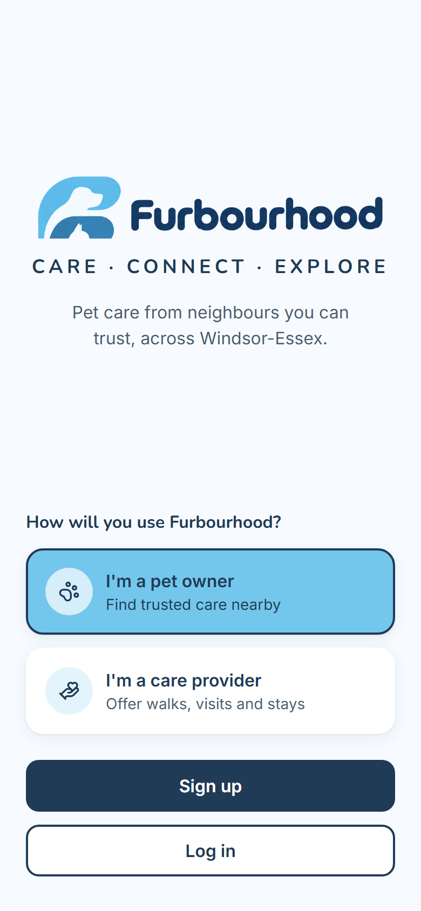
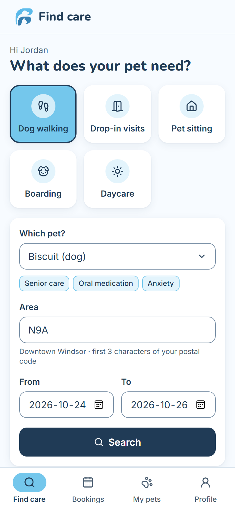
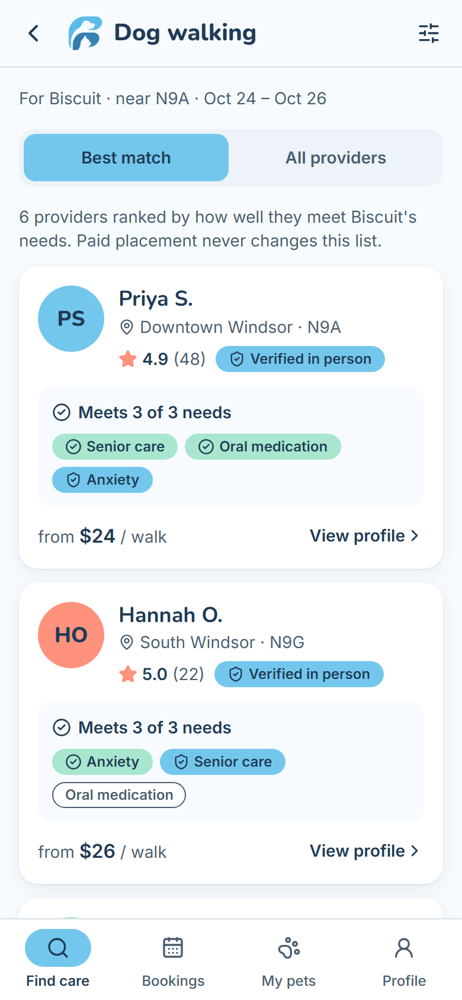
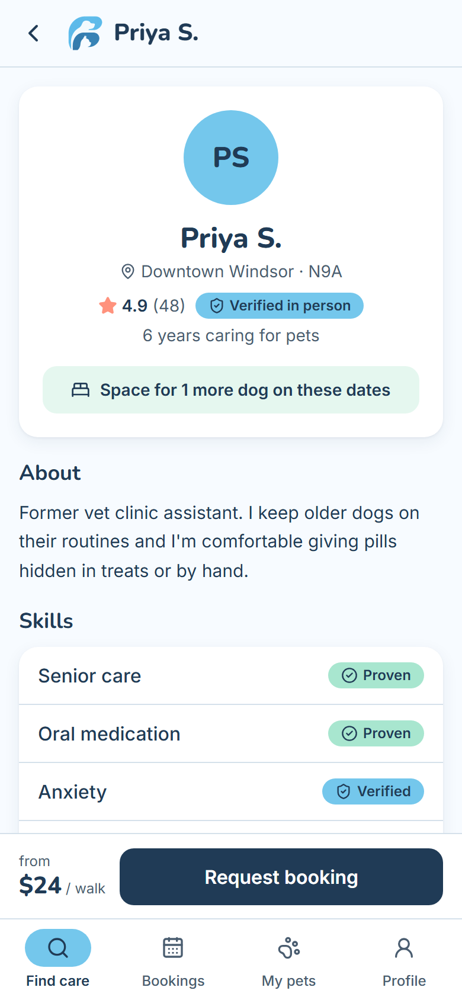
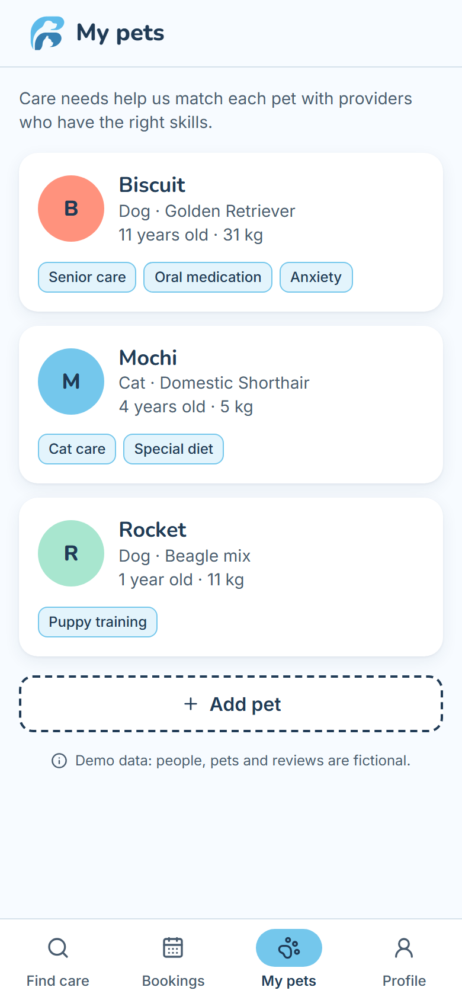
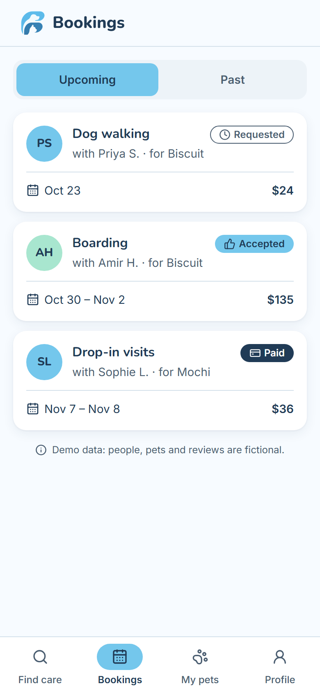

# Furbourhood

**Pet care from neighbours you can trust, across Windsor-Essex, Ontario.**

Furbourhood is a local pet-care marketplace that matches pet owners with walkers, sitters and boarders
based on what their pet actually needs (senior care, oral medication, anxiety and more), not on who paid
for placement. It is my university capstone MVP: a phone-first React app that will later be packaged for
Android with Capacitor.

> **Status:** design and app shell. All screens are built and navigable with fictional demo data; there is no backend yet.

<p>
  
  
  
</p>
<p>
  
  
  
</p>

## Highlights

- **Needs-based matching.** The "Best match" tab ranks providers only by how many of the pet's care needs
  they cover, then by the strength of those skills, in-person verification and rating
  ([`src/lib/match.ts`](src/lib/match.ts)). Featured (paid) placement can never change this list; it only
  appears on the separate "All providers" tab.
- **Three-tier trust model.** Every provider skill is Self-declared, Verified (checked by the platform) or
  Proven (confirmed by 3+ owners), rendered through one shared `LevelBadge` component so the meaning is
  consistent on every screen.
- **Component-driven UI.** Screens only assemble reusable components (`ProviderCard`, `PetCard`,
  `BookingCard`, `LevelBadge`, `NeedChip`, `StatusChip`…). A living style guide lives at `/styleguide`.
- **Accessible brand system.** Colour tokens chosen so every text/background pair meets WCAG AA; tooltips
  open on tap as well as hover for Android.
- **Offline-ready.** Fonts are bundled with `@fontsource` rather than loaded from a CDN, so the app works
  inside an Android WebView with no network.
- **Strict TypeScript** with `noUncheckedIndexedAccess`, and typed mock data in `src/types.ts` ready to be
  swapped for a real backend.

## Tech stack

React 19 · TypeScript (strict) · Vite · Tailwind CSS v4 · shadcn/ui (Radix) · React Router · Lucide icons

## Run it locally

Requires Node.js 20.19 or newer.

```bash
npm install
npm run dev
```

Then open http://localhost:5173. Other scripts: `npm run typecheck` and `npm run build`.

## Screens

| Route | Screen |
|---|---|
| `/` | Welcome (owner or provider) |
| `/find` | Find care: service, pet, area and dates |
| `/results` | Best match / All providers |
| `/providers/:id` | Provider profile with skills and rates |
| `/pets` | My pets and their care needs |
| `/bookings` | Bookings: Requested → Accepted → Paid → Completed |
| `/profile` | Profile |
| `/styleguide` | Component style guide |

## Project structure

```
src/
  components/     reusable UI (cards, badges, app bar, tabs) + shadcn/ui primitives in ui/
  screens/        one file per route; screens only assemble components
  lib/            matching, search and formatting logic
  mocks/          fictional Windsor-Essex demo data (8 providers, 3 pets, 5 bookings)
  types.ts        domain types shared by mocks and (later) the backend
```

## Roadmap

- [x] Brand system, component library and all owner screens
- [ ] Supabase backend: auth, providers, pets, bookings
- [ ] Booking request and acceptance flow
- [ ] Stripe test-mode payments
- [ ] Android build with Capacitor

## Notes

All people, pets, reviews and bookings in this app are fictional demo data.
