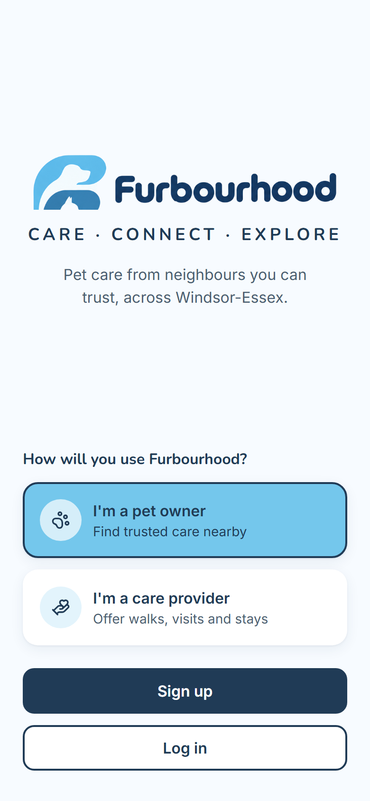
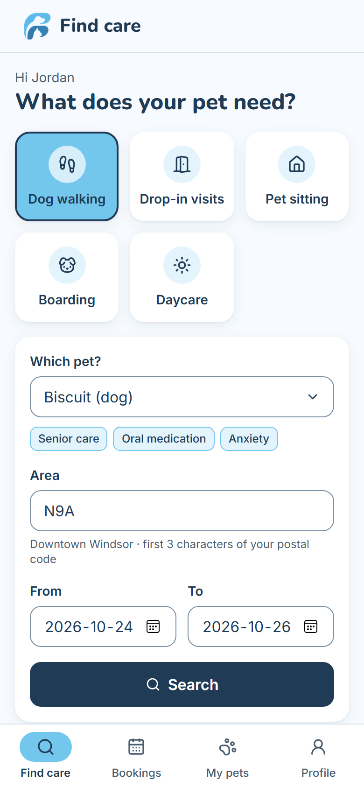
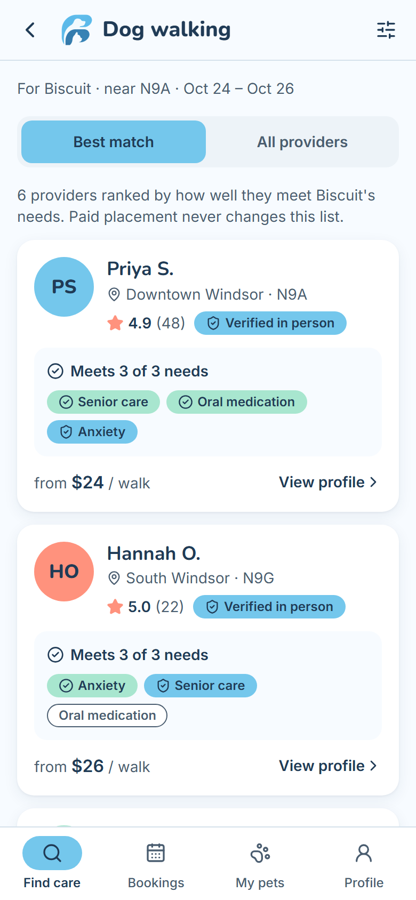
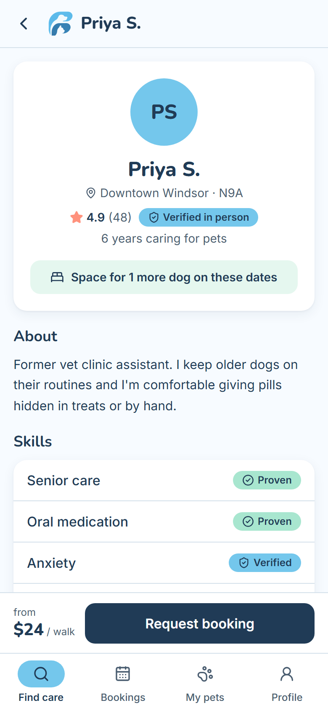
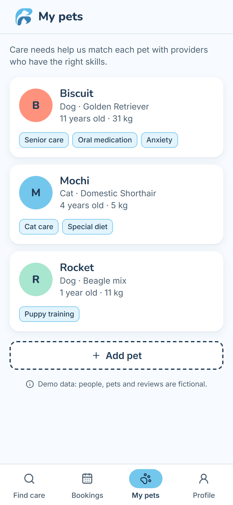
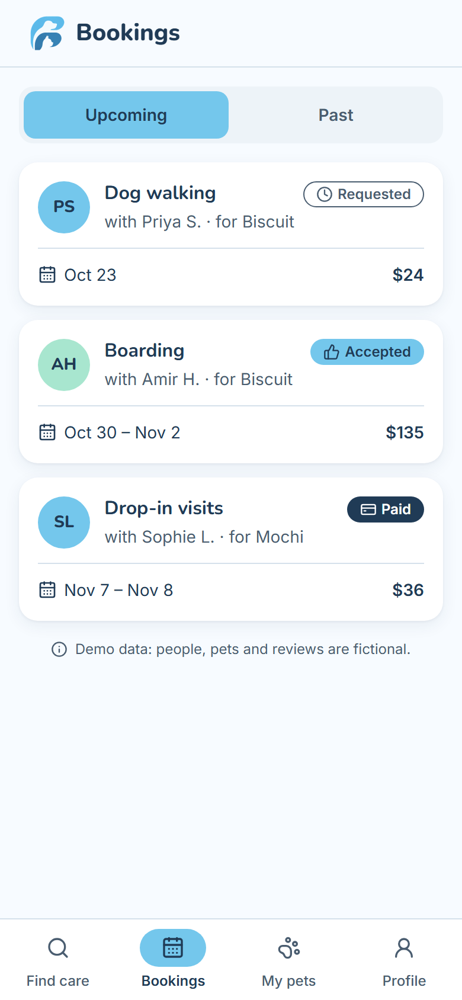

# Furbourhood

**Pet care from neighbours you can trust, across Windsor-Essex, Ontario.**

Furbourhood is a local pet-care marketplace that matches pet owners with walkers, sitters and boarders
based on what their pet actually needs (senior care, oral medication, anxiety and more), not on who paid
for placement. It is my university capstone MVP: a phone-first React app that will later be packaged for
Android with Capacitor.

> **Status:** connected to a Supabase backend with email log-in. Providers, pets and bookings come from the
> database; the providers and starter pets are fictional demo data.

<p>
  
  
  
</p>
<p>
  
  
  
</p>

## Highlights

- **Needs-based matching.** The "Best match" tab ranks providers only by how many of the pet's care needs
  they cover, then by the strength of those skills, in-person verification and rating
  ([`src/lib/match.ts`](src/lib/match.ts)). Featured (paid) placement can never change this list; it only
  appears on the separate "All providers" tab.
- **Three-tier trust model.** Every provider skill is Self-declared, Verified (checked by the platform) or
  Proven (confirmed by 3+ owners), rendered through one shared `LevelBadge` component so the meaning is
  consistent on every screen.
- **Component-driven UI.** Screens only assemble reusable components (`ProviderCard`, `PetCard`,
  `BookingCard`, `LevelBadge`, `NeedChip`, `StatusChip`…). A living style guide lives at `/styleguide`.
- **Accessible brand system.** Colour tokens chosen so every text/background pair meets WCAG AA; tooltips
  open on tap as well as hover for Android.
- **Offline-ready.** Fonts are bundled with `@fontsource` rather than loaded from a CDN, so the app works
  inside an Android WebView with no network.
- **Strict TypeScript** with `noUncheckedIndexedAccess`, and typed mock data in `src/types.ts` ready to be
  swapped for a real backend.

## Tech stack

React 19 · TypeScript (strict) · Vite · Tailwind CSS v4 · shadcn/ui (Radix) · React Router · Lucide icons · Supabase (auth + Postgres)

## Run it locally

Requires Node.js 20.19 or newer and a free [Supabase](https://supabase.com) project.

1. **Set up the database.** In the Supabase dashboard, open **SQL Editor** and run, in order:
   `supabase/migrations/0001_init.sql`, then `supabase/seed.sql`.
2. **Connect the app.** Copy `.env.example` to `.env.local` and fill in the Project URL and the
   **publishable** key from **Project Settings → API Keys**. Never use the secret key here.
3. **Run it:**

   ```bash
   npm install
   npm run dev
   ```

Then open http://localhost:5173 and sign up. New owner accounts start with three demo pets and a few
demo bookings. Supabase asks new users to confirm their email by default; for quick local testing you
can turn that off under **Authentication → Sign In / Providers → Email**.

Other scripts: `npm run typecheck` and `npm run build`.

## Screens

| Route | Screen |
|---|---|
| `/` | Welcome (owner or provider) |
| `/signup`, `/login` | Sign up and Log in (email and password) |
| `/find` | Find care: service, pet, area and dates |
| `/results` | Best match / All providers |
| `/providers/:id` | Provider profile with skills and rates |
| `/pets` | My pets and their care needs |
| `/bookings` | Bookings: Requested → Accepted → Paid → Completed |
| `/profile` | Profile |
| `/styleguide` | Component style guide |

## Project structure

```
src/
  auth/           session provider and the guard for signed-in screens
  components/     reusable UI (cards, badges, app bar, tabs, loading/error states) + shadcn/ui primitives in ui/
  data/           Supabase queries mapped to app types, and the hooks screens use
  screens/        one file per route; screens only assemble components
  lib/            matching, search, formatting and the Supabase client
  mocks/          static demo data for the /styleguide page
  types.ts        domain types shared by the whole app
supabase/
  migrations/     schema and Row Level Security policies
  seed.sql        fictional Windsor-Essex providers, skills, rates and reviews
```

## Security

Every table has Row Level Security. Owners can only read and change their own pets and bookings, providers
only see bookings sent to them, and listings and reviews are visible to signed-in users only. That is what
makes it safe for the app to ship the publishable key.

## Roadmap

- [x] Brand system, component library and all owner screens
- [x] Supabase backend: auth, providers, pets, bookings
- [ ] Add and edit pets
- [ ] Booking request and acceptance flow
- [ ] Stripe test-mode payments
- [ ] Android build with Capacitor

## Notes

All people, pets, reviews and bookings in this app are fictional demo data.
